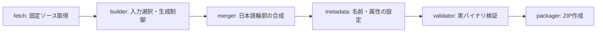

# アーキテクチャ

ソース取得からTTF生成・検証・ZIP配布までの流れと、各モジュールの責務を説明します。入力・設定・実装を追跡するためのキャッシュとマニフェストの役割もまとめています。

[ドキュメント一覧](README.md) · [プロジェクトREADME](../README.md)

## 処理の流れ

次の図は論理的な処理順です。`builder`は`merger`と`metadata`を呼び出して生成を取りまとめ、`validator`は保存後やパッケージ作成時にも使われます。

| 段階 | 実装 | 責務 |
| --- | --- | --- |
| `fetch` | `downloader.py` / `source_registry.py` | 固定URLから取得し、ロックのSHA-256を確認してキャッシュへ保存します。展開後に名前・ウェイト・可変軸・文字集合を解析します。 |
| `builder` | `builder.py` | 対象のベース系列・日本語書体・ウェイト・スタイルに応じて入力を選びます。必要な可変軸を固定し、合成・保存とマニフェスト作成を制御します。 |
| `merger` | `merger.py` | 日本語輪郭を分解・二次曲線化し、UPM正規化・中央配置・幅調整を行います。Cascadiaの元グリフ順を維持して末尾へ追加し、元のレイアウトテーブルを保持します。 |
| `metadata` | `metadata.py` | 独自ファミリー名、スタイルリンク、ライセンスなどのメタデータを設定します。メタデータ契約の検査関数も提供します。 |
| `validator` | `validator.py` | 保存したフォントの整合性・幅・メタデータと、元テーブルの保持を検証します。HarfBuzzが利用できる場合は元Cascadiaとのシェーピング比較も行います。 |
| `packager` | `packager.py` | TTF、配布用マニフェスト、ライセンスをファミリー別ZIPへまとめます。固定メタデータと並び順で再現可能な配布物を作ります。 |

実装は`src/kumitype/`以下にあります。ここでのベース系列・日本語書体・ファミリーの定義は[プロジェクトREADME](../README.md#生成できるフォント)に従います。

## ネットワークと入力の境界

通常の生成パイプラインでネットワークに接続するのは`fetch`だけです。`import-source`は固定ハッシュを持つローカル配布物を登録し、`update-source`はロックを変更するだけでダウンロードしません。

同じ日本語書体・ウェイトの補完的な分割フォントは、追加カバーを持つ入力を自動選択し、重複文字を避けて統合します。追加の著作権・ライセンスメタデータと、明示指定した追加ライセンス文書も保持します。

> [!NOTE]
> 日本語側のヒンティングとOpenType機能は継承しません。IVSの完全継承も保証対象外です。Cascadia側の保持方針とは区別してください。

## キャッシュと再現性

| 保存先（既定） | 内容 | 再利用の基準 |
| --- | --- | --- |
| `cache/`直下 | 取得した固定ソース | SHA-256 |
| `cache/instances/` | 可変フォントからの静的インスタンス | 入力ハッシュ・軸などの設定・依存版 |
| `cache/outlines/` | 変換済み日本語輪郭 | 入力ハッシュ・変換設定・依存版 |
| `source/` | 展開したソース・ライセンス・取得マニフェスト | ロック情報と展開ファイルのハッシュ |

パス基準と`--cache-dir`、再現可能なZIPの仕様は[ビルドガイド](BUILDING.md#設定パスキャッシュ)を参照してください。

## マニフェストによる追跡

ビルドマニフェストの`builder`には、ワーカー起動時のPythonソース一式のSHA-256、Pythonと依存パッケージの版を保存します。動作比較では入力ハッシュだけでなく、この実装情報も確認してください。

ビルド出力側のJSONにはローカルパス・元の設定ハッシュ・実測時間を保持します。一方、ZIP内のJSONはローカル保存先と実測値を除外し、配布用設定から`config_sha256`を再計算します。

ビルド中にコードを編集すると生成物ごとに実装情報が異なり得るため、比較する実装を固定してから生成してください。実装情報のない古い生成物とは区別して扱います。
